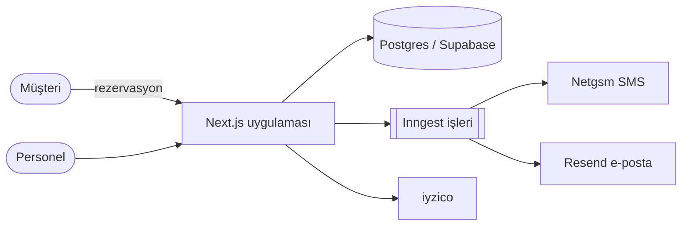

# Sky · Mimari Dokümanlar

## README (her repo)

```
# Proje — tek cümle
Ekran görüntüsü / demo bağlantısı
## Hızlı başlangıç (≤ 5 komut)
## Mimari (1 diyagram + 5 madde)
## Komutlar
## Ortam değişkenleri (→ docs/ENV.md)
## Dağıtım
## Katkı / kurallar (→ CLAUDE.md)
```

## ADR — Mimari Karar Kaydı

Ne zaman: geri dönmesi pahalı kararlar (DB, auth sağlayıcı, monorepo, ödeme sağlayıcı, multi-tenancy modeli),
"neden böyle?" sorusunun tekrar soracağı kararlar.

```markdown
# ADR-007: Randevu saatlerini işletme saat diliminde saklıyoruz
Tarih: 2026-11-04 · Durum: Kabul edildi
## Bağlam
İşletmeler farklı şehirlerde; çalışma saatleri yerel duvar saati…
## Karar
`working_hours` yerel saat + `timezone`; `bookings` timestamptz (UTC).
## Değerlendirilen alternatifler
1. Her şey UTC — yaz saati olan bölgelerde çalışma saatleri kayar. 2. …
## Sonuçlar
+ … − slot hesaplamasında dilim dönüşümü gerekir (lib/slots.ts).
```
`docs/adr/NNN-kebab-baslik.md`, numaralı, değiştirilmez (yeni karar eskisini "Yerini aldı: ADR-012" ile işaretler).

## C4 + Mermaid


- Seviye 1 bağlam (sistem + kullanıcılar + dış sistemler), seviye 2 konteynerler (uygulama, DB, kuyruk, CDN). Çoğu projede ikisi yeter.
- Akışlar için sıra diyagramı (`sequenceDiagram`): ödeme, webhook, randevu oluşturma.
- Mermaid GitHub ve çoğu doküman aracında render olur; diyagram kodla birlikte sürümlenir.

## CODEMAP

`docs/CODEMAP.md`: klasör → sorumluluk → giriş noktaları → "şunu değiştirmek istersen buraya bak". 1 ekran.
Yeni geliştirici ve AI için en hızlı yönlendirme (`sky-codebase-mapper` agent'ı üretebilir).

## Güncel tutma

- Doküman kodun yanında (repo içinde), PR kontrol listesinde "doküman güncellendi mi?".
- Diyagramları koddan türet (mümkünse): şemadan ERD (`drizzle-kit`/`prisma-erd-generator`), OpenAPI'den API dokümanı.
- Eskimiş doküman "⚠️ güncel değil" işaretlenir veya silinir.
